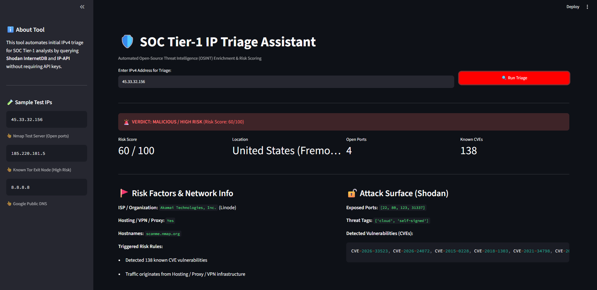

# 🛡️ SOC Tier-1 IP Triage Assistant


An automated Open-Source Intelligence (OSINT) enrichment and risk-scoring dashboard designed for **Tier-1 SOC Analysts**. This tool streamlines the initial triage of suspicious IPv4 indicators of compromise (IoCs) without requiring commercial API keys.

---

## 📸 Dashboard Preview



---

## 🎯 Problem Statement (Why this tool?)

During high-volume alert shifts, Tier-1 SOC analysts spend significant time manually pivoting across multiple browser tabs to check IP geolocation, ASN/ISP ownership, open ports, and known vulnerabilities. 

**SOC Tier-1 IP Triage Assistant** automates this workflow into a single click:
1. **Collects Telemetry:** Queries **Shodan InternetDB** (exposed ports, CVEs, threat tags) and **IP-API** (Geolocation, ISP, Hosting/Proxy detection).
2. **Evaluates Risk:** Runs a deterministic heuristic scoring engine (`0-100`) to classify artifacts into `BENIGN`, `SUSPICIOUS`, or `MALICIOUS`.
3. **Standardizes Reporting:** Generates a ready-to-paste Markdown investigation note for ticketing systems (Jira, TheHive, ServiceNow).

---

## ⚙️ Risk Scoring Heuristics

| Indicator | Condition | Score Weight | SOC Context |
| :--- | :--- | :--- | :--- |
| **Known Vulnerabilities** | `CVEs > 0` | `+40 pts` | Unpatched services increase compromise likelihood |
| **Threat Tags** | `tor`, `vpn`, `scanner`, `honeypot`, `malware` | `+30 pts` | Known anonymizers or scanning infrastructure |
| **Non-Residential Network** | `Hosting / Proxy == True` | `+20 pts` | Datacenter origin (anomalous for standard user logins) |
| **High Attack Surface** | `Open Ports > 5` | `+10 pts` | Multiple exposed services on a single host |

* **60 – 100 pts:** 🚨 `MALICIOUS / HIGH RISK`
* **30 – 59 pts:** ⚠️ `SUSPICIOUS / MEDIUM RISK`
* **0 – 29 pts:** ✅ `BENIGN / LOW RISK`

---

## 🚀 Quick Start (Local Installation)

```bash
# 1. Clone the repository
git clone [https://github.com/YOUR_USERNAME/soc-ioc-triage.git](https://github.com/YOUR_USERNAME/soc-ioc-triage.git)
cd soc-ioc-triage

# 2. Install dependencies
pip install -r requirements.txt

# 3. Launch the dashboard
streamlit run app.py