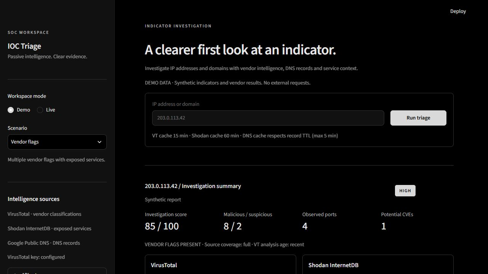
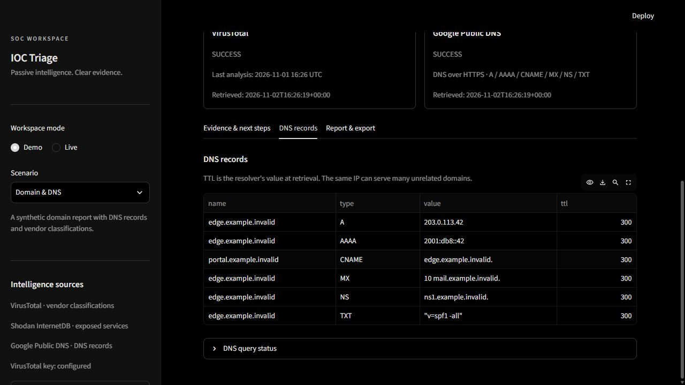

# SOC L1 IOC Triage Assistant

A personal SOC lab and portfolio project for passive IPv4 and domain enrichment.
Combines VirusTotal vendor classifications, Google Public DNS records and Shodan
InternetDB service exposure in a minimal Streamlit workspace.

Built for SOC L1 portfolio demonstrations: one input accepts an IP address or
domain, keeps source failures visible, and produces an investigation note with
the evidence, limitations and recommended next step.

The tool helps prioritize investigation. Final disposition requires an analyst
to review the original alert and event evidence.



## Features

| Input | Intelligence sources | Result |
| --- | --- | --- |
| Public IPv4 | VirusTotal + Shodan InternetDB | Vendor classifications, network owner, observed ports, potential CVEs and infrastructure tags |
| Domain / hostname | VirusTotal + Google Public DNS | Domain classifications, DNS records, resolved IPs and available registration metadata |

The interface uses a black background and light gray controls and text. Priority
labels remain explicit; badge contrast and borders distinguish states without
relying on red/green colors. Domain reports include a dedicated **DNS records** tab.

- VirusTotal API v3: malicious/suspicious vendor counts, flagged vendors, analysis
  date, country, ASN and community reputation.
- Shodan InternetDB: observed ports, potential CVEs, hostnames and infrastructure tags.
- Domains: A, AAAA, CNAME, MX, NS and TXT records via Google Public DNS over HTTPS,
  plus a dedicated VT domain report, registrar and registration date where available.
- Separate investigation priority, source coverage and intelligence freshness.
- Explicit missing-key, no-data, authentication, quota and network-error states.
- Independent source handling: a failed provider does not discard the other report.
- Memory cache: 15 minutes for VT, 60 minutes for Shodan, 5 minutes for missing records.
- Process-local VT request spacing and daily allowance guard.
- Markdown ticket note and JSON download, including limitations and source timestamps.
- Six clearly labeled offline scenarios, with no external requests.
- Public unicast IPv4 and domain validation, with IDN normalization, before any request.

## Run locally (PowerShell)

Verified locally with Python 3.14 and Streamlit 1.66.1.

```powershell
git clone https://github.com/aeizy/soc-l1-triage-assistant.git
cd soc-l1-triage-assistant
py -m venv .venv
.\.venv\Scripts\python.exe -m pip install -r requirements.txt
.\.venv\Scripts\python.exe -m streamlit run app.py
```

The app opens in Demo mode. Synthetic results use a documentation-only address,
invented vendor names and a clearly fictional CVE. They do not describe a real IP.

## IP and domain investigation

In Live mode, enter a public IPv4 address or a bare domain, such as `example.com`.
Do not include `https://`, a path or a port. Internationalized names are normalized
to their ASCII IDN form; local/reserved names and invalid addresses are rejected.

- **IP**: one VT IP report and a Shodan InternetDB lookup.
- **Domain**: one VT domain report and six DNS queries (A, AAAA, CNAME, MX, NS, TXT).
  DNS works without an API key. There are no website visits or port scans.
- DNS results include record owner, value, TTL at retrieval, resolved IPv4/IPv6,
  and a per-type status. NXDOMAIN, absent records, SERVFAIL, truncation and HTTP/network
  failures remain distinct. Partial DNS failures preserve the other records.
- Positive DNS answers are cached for at most 5 minutes, bounded by the shortest
  returned record TTL. TTL=0, negative answers and failures are not cached locally.
- DNSSEC AD=true reflects resolver validation. AD=false alone does not prove a
  validation failure or malicious activity. DNS records and registration age do not
  add priority points.
- Shodan does not accept domain names here. To inspect a resolved public IPv4's
  services, run a separate IP lookup. Shared hosting IPs do not establish a domain's reputation.

Choose **Domain & DNS** in Demo mode for synthetic records without any requests.



## VirusTotal key

Obtain your own Community API key:
[Getting started](https://docs.virustotal.com/reference/getting-started).

Copy `.streamlit/secrets.toml.example` to `.streamlit/secrets.toml` and set:

```toml
VT_API_KEY = "your-key-here"
```

Alternatively set the environment variable before starting Streamlit:

```powershell
$env:VT_API_KEY = "your-key-here"
.\.venv\Scripts\python.exe -m streamlit run app.py
```

Restart after changing configuration. Environment configuration takes precedence.
The real secrets file and `.env` are ignored by Git; `.env` files are not
automatically loaded. Do not put a real key into the example file.

For Streamlit Community Cloud, add the same `VT_API_KEY` setting through the
application's Secrets settings instead of committing a local secrets file.
Only the empty example file belongs in the repository.
See [Streamlit's secrets management guide](https://docs.streamlit.io/deploy/streamlit-community-cloud/deploy-your-app/secrets-management).

Shodan **InternetDB** requires no key. This project does not use the paid Shodan
host-search API. Missing VT configuration leaves Shodan results available and
priority unassessed. The same VT key supports both IP and domain reports;
Google Public DNS also requires no key.

## Investigation policy v2.0

| VirusTotal observation | Points |
| --- | ---: |
| 0 malicious classifications | 0 |
| 1 malicious classification | 25 |
| 2–4 malicious classifications | 45 |
| 5+ malicious classifications | 70 |
| One or more suspicious classifications | +15 |

Priority: **Low** 0–14; **Medium** 15–69; **High** 70–100.
The current rules produce at most 85 points; 100 is the scale ceiling.

These thresholds are project heuristics, not a validated model or an attack
probability. Vendors can share intelligence; counts do not prove independent
confirmation.

- Ports, potential CVEs, VPN/hosting/Tor tags and community reputation add **no points**.
- Missing records, quota errors, empty/incomplete vendor statistics and provider
  failures never imply safety. A priority score is absent when assessment is unavailable.
- Vendor reports without a known analysis date or older than 30 days carry a warning.
  If such a report has no flags, priority is unassessed until fresh evidence is available.
  Historical flags stay visible with the age warning.
- Full coverage means both applicable sources responded and VT has usable classifications.
  It does not establish accuracy, freshness or a completed incident investigation.
- Undetected means the vendor has no opinion; it does not mean harmless.

## API limits and data handling

For this non-commercial educational project, the VT Public API documentation lists
**4 requests/minute and 500 requests/day**. The client spaces VT attempts by at least
16 seconds, respects HTTP 429 / Retry-After, and caches successful lookups.
There are no automatic retries. Daily counts reset at 00:00 UTC.

The guard and cache are in memory and shared by sessions in one app process using
the same configured key. Restarts, multiple processes, or other tools using that
key are outside this guard; provider quotas remain authoritative.
Avoid publicly exposing an app with your personal key.

Live IP mode sends the IP to VT and Shodan; domain mode sends the name to VT and
Google Public DNS. No API key is sent to Google or Shodan. Google DNS queries set
`edns_client_subnet=0.0.0.0/0`. No files are uploaded
and no explicit rescan endpoint is called. VT documents that queried indicators
may be scanned and included in its community dataset. Use only non-sensitive lab
indicators.

InternetDB is updated weekly. Its potential CVEs are inferred from service
metadata and are not a confirmed vulnerability assessment or a live port scan.

References:
- [VT IP report](https://docs.virustotal.com/reference/ip-info)
- [VT IP attributes](https://docs.virustotal.com/reference/ip-object)
- [VT domain reports](https://docs.virustotal.com/reference/domain-info)
- [Google DNS over HTTPS JSON API](https://developers.google.com/speed/public-dns/docs/doh/json)
- [VT Public API constraints](https://docs.virustotal.com/reference/public-vs-premium-api)
- [Shodan InternetDB](https://internetdb.shodan.io/)

## Tests

Tests use the standard library and Streamlit AppTest. No real keys or network
requests are needed.

```powershell
.\.venv\Scripts\python.exe -m unittest discover -s tests -v
```

Coverage includes priority boundaries, exposure without vendor flags, incomplete
data, old intelligence, validation, HTTP errors, malformed JSON, secret isolation,
cache expiry, quotas, domain normalization, DNS response codes, TTL handling,
source/key isolation, demo scenarios, and UI transitions.
The suite currently contains 34 passing tests, including the Streamlit UI smoke check.

CLI (uses the environment variable for VT configuration):

```powershell
.\.venv\Scripts\python.exe scanner.py 8.8.8.8
.\.venv\Scripts\python.exe scanner.py example.com
```

## Layout

```text
app.py                       Streamlit interface
scanner.py                   Provider client, normalization and policy
indicators.py                Public IPv4/domain validation and IDN normalization
dns_lookup.py                DNS over HTTPS, record parsing and TTL cache
demo.py                      Synthetic offline scenarios
reporting.py                 Portable investigation notes
tests/                       Scanner and UI checks
.streamlit/config.toml        Black / light gray theme
.streamlit/secrets.toml.example
screenshots/domain-dns.png    Synthetic domain/DNS demo
requirements.txt
```
